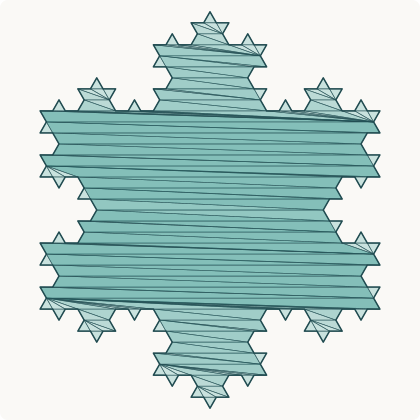
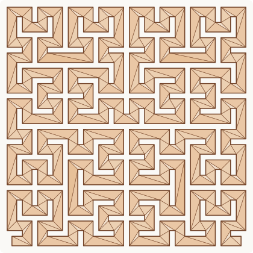
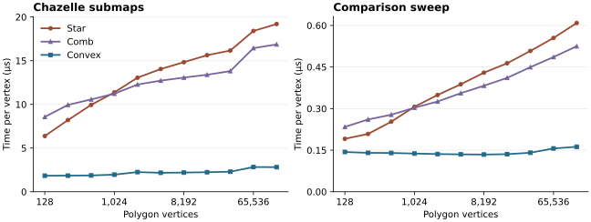

# Chazelle triangulation

A Rust implementation of Chazelle’s deterministic coarse-to-fine visibility algorithm for simple polygons. It accepts either winding, horizontal edges and collinear boundary vertices. Coordinates are signed 32-bit integers. The result contains `n − 2` counterclockwise triangles indexed into the original boundary.

The implementation uses canonical submaps, two directional fusion walks, separator-based horizontal ray shooting, and Fournier–Montuno triangulation. The separator construction and the scheduling of down-phase cuts differ from the published procedures. The bounds and counterexamples are in [DEVIATIONS.md](DEVIATIONS.md). [Chazelle’s paper](https://www.cs.princeton.edu/~chazelle/pubs/polygon-triang.pdf)

## Triangulations

| Koch snowflake | Hilbert corridor |
|:---:|:---:|
| [](docs/figures/koch-snowflake.svg) | [](docs/figures/hilbert-corridor.svg) |
| 192 vertices · 190 triangles | 412 vertices · 410 triangles |

## Run

Pass a simple boundary to `chazelle::triangulate(&[Point])`, omitting the repeated closing vertex. The command-line program reads one `x y` pair per line and writes zero-based triangle indices.

```sh
printf '0 0\n4 0\n4 3\n2 1\n0 3\n' | cargo run --quiet --release
cargo test --release
```

Simplicity is a caller precondition. The library checks the vertex count, adjacent duplicates, and signed area. It takes one boundary without holes.

## Scaling



Both panels include triangle extraction and have separate vertical scales. On star polygons, doubling from 524,288 to 1,048,576 vertices raised median time per vertex from 20.3 to 20.7 µs for submaps and from 0.78 to 0.91 µs for the O(n log n) AVL sweep. A separate submap run on the million-vertex star used 3.4 GiB of peak resident memory. The worst-case O(n) bound is derived in [DEVIATIONS.md](DEVIATIONS.md).

Reproduce the [raw medians](bench/scaling.csv) with `cargo run --release --example scaling > bench/scaling.csv`. Run `python3 bench/plot.py` with Matplotlib installed to redraw the chart. The chart uses Rust 1.100 on one Cortex-X925 core, one warmup, and five timed runs per point.
